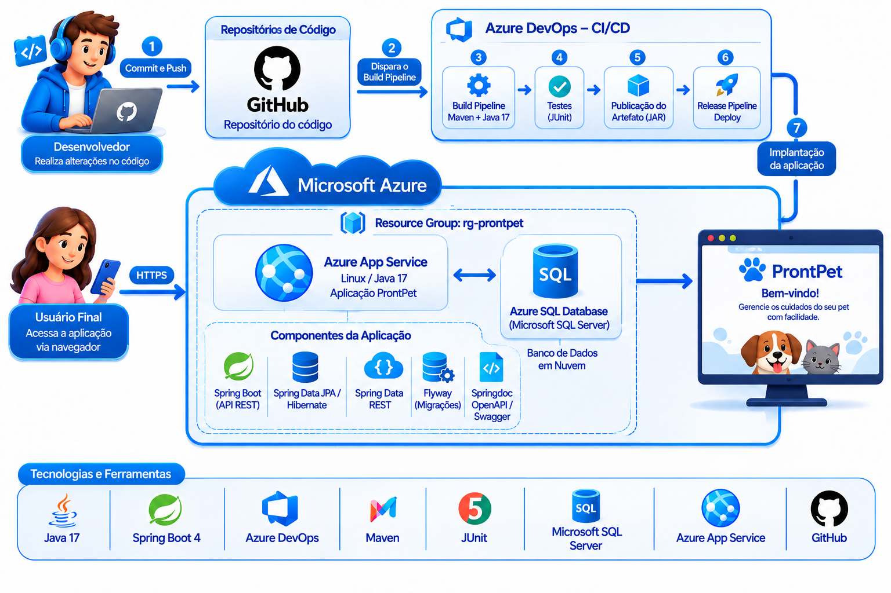

# ProntPet

**Integrantes:**  
- Anthony de Souza Henriques — RM 566188  
- Guilherme Santos Fonseca — RM 564232  
- Gustavo Araujo da Silva — RM 566526  

## Repositório

- GitHub:
  
  https://github.com/Challenge-2TDSPX-2026/ProntPet-Pipelines-Sprint4.git

- Vídeo:
  
  https://youtu.be/kIto_wLHg4c?si=ataRskDGePs_wDHD

- Projeto no Azure DevOps:
  
  https://dev.azure.com/rm566526/Sprint%204%20%E2%80%93%20Azure%20DevOp

# ProntPet

## 1. Descrição da solução

O **ProntPet** tem como objetivo aproximar **tutores e veterinários**, permitindo o gerenciamento de pets, consultas e informações relacionadas ao atendimento veterinário de forma simples e organizada.

O tutor consegue gerenciar seus pets, consultar informações de saúde, agendar consultas e acompanhar o histórico médico.

O veterinário possui uma consegue visualizar consultas, tutores, pets e informações dos atendimentos.

---

# 🎯 Objetivo

O ProntPet busca centralizar informações importantes relacionadas à saúde dos animais em uma aplicação mobile.

Através do aplicativo, o usuário pode:

* cadastrar e visualizar pets;
* consultar informações do animal;
* acompanhar consultas;
* realizar agendamentos;
* cancelar consultas futuras;
* visualizar histórico médico;
* consultar sintomas;
* visualizar diagnósticos;
* consultar observações veterinárias;
* acompanhar informações de vacinação;
* acessar informações de clínicas;
* permitir que veterinários acompanhem seus atendimentos.

---

**Stack de tecnologias utilizadas:**

- **Java 17** – linguagem de programação.
- **Spring Boot 4** – desenvolvimento da API REST.
- **Spring Data JPA / Hibernate** – persistência e mapeamento dos dados.
- **Spring Data REST** – exposição de recursos por meio de endpoints REST.
- **Microsoft SQL Server (Azure SQL Database)** – banco de dados relacional em nuvem.
- **Flyway** – controle e versionamento das alterações do banco de dados.
- **Springdoc OpenAPI / Swagger** – documentação e visualização dos endpoints da API.
- **Azure App Service** – hospedagem da aplicação.
- **Azure DevOps** – gerenciamento do repositório e automação dos processos de Build e Release.
- **GitHub** – armazenamento e versionamento do código-fonte.

---

# Diagrama da Arquitetura + Fluxo CI/CD

